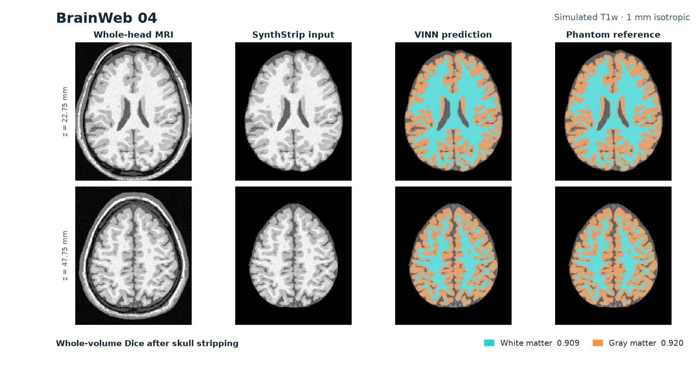

# FastSurfer VINN Axial

FastSurfer VINN Axial is a 1.63M-parameter PyTorch model for brain MRI segmentation. The frozen VINN also provides a segmentation consistency loss for **MRI super-resolution, image reconstruction, and cross-modal synthesis**.

The model is adapted from FastSurferVINN. It takes a single T1-weighted, T2-weighted, or FLAIR NIfTI volume and returns **34 anatomical labels plus background** using FreeSurfer aseg IDs. The output preserves the input shape and affine.

## Segmentation results

Evaluated on all **20 BrainWeb T1-weighted digital brain phantoms** at 1 mm isotropic resolution. Dice was computed over each full volume against the corresponding phantom tissue labels.

| Model | White matter Dice (mean ± SD) | Gray matter Dice (mean ± SD) |
| --- | ---: | ---: |
| Axial VINN | **0.9141 ± 0.0070** | **0.9253 ± 0.0087** |
| SynthSeg 2.0 | 0.9084 ± 0.0104 | 0.9086 ± 0.0098 |



*BrainWeb phantom 04. Cyan marks white matter and orange marks gray matter.* [Evaluation protocol and results for all 20 phantoms](benchmarks/brainweb20.md)

See the [public hMRI MPM case](benchmarks/hmri-mpm-echo6.md) for a three-plane comparison with official FastSurfer on a late-echo T1-weighted GRE scan.

## Quick start

Use Python 3.11 or newer and Git LFS. Install PyTorch for your CPU or accelerator first, then install the project dependencies. [PyTorch installation guide](https://pytorch.org/get-started/locally/)

```bash
git lfs install
git clone https://github.com/So-cean/fastsurfer-vinn-axial.git
cd fastsurfer-vinn-axial
git lfs pull
python -m pip install -e .
```

To keep a specific PyTorch build in an existing environment, pass a [pip constraints file](https://pip.pypa.io/en/stable/user_guide/#constraints-files) that pins the installed build when resolving the remaining dependencies.

The editable install makes `fastsurfer_vinn` importable from other projects in the same Python environment. Pass an explicit path to `checkpoints/best.pth` when calling the loss from another project. Git LFS provides the checkpoints in the checkout.

## Inference and preprocessing

### 1. Skull-strip the input

**VINN expects a skull-stripped 3D NIfTI with exactly zero outside the brain.** Keep the scan's original intensities, sampling grid, and affine. For a whole-head scan, generate a brain mask with SynthStrip and apply it to the original image. The mask-based example sets the background to zero even when the source has negative intensities. [SynthStrip](https://surfer.nmr.mgh.harvard.edu/docs/synthstrip/)

```bash
mri_synthstrip -i t1.nii.gz -m t1_brain_mask.nii.gz
python - <<'PY'
import nibabel as nib
import numpy as np

image = nib.load("t1.nii.gz")
mask = nib.load("t1_brain_mask.nii.gz")
if image.shape != mask.shape or not np.allclose(image.affine, mask.affine, atol=1e-5):
    raise ValueError("The brain mask must be on the input image grid.")

data = image.get_fdata(dtype=np.float32)
brain = np.where(mask.get_fdata() > 0, data, 0)
stripped = nib.Nifti1Image(brain, image.affine, image.header.copy())
stripped.set_data_dtype(np.float32)
nib.save(stripped, "t1_brain.nii.gz")
PY
```

### 2. Run VINN on the native grid

```bash
python -m fastsurfer_vinn.inference --input t1_brain.nii.gz --output outputs/t1_seg.nii.gz --clip
```

Use the same command directly on an already skull-stripped volume with a zero background. The CLI reorders and flips voxel axes to RAS for axial slicing. This preserves native sampling and any acquisition tilt. With `--clip`, it computes the **0.5th–99.5th percentiles over the full volume** and clips first. It always applies one **nonzero-voxel z-score per volume** before slicing. The CLI selects CUDA when available and uses CPU otherwise. The output is an `int16` aseg label map with the input shape and affine. [Label IDs](fastsurfer_vinn/utils/labels.py)

### Scale factor

Store voxel spacings in millimetres in the NIfTI header. After reordering to RAS, the CLI slices along Z and reads the **axial in-plane spacing** from the header. It passes `scale_factor = 1 mm / in_plane_spacing` to VINN for interpolation of feature maps inside the network. Through-plane spacing can differ.

| Axial in-plane spacing | `scale_factor` |
| ---: | ---: |
| 0.5 mm | 2.00 |
| 0.8 mm | 1.25 |
| 1.0 mm | 1.00 |

For example, a RAS grid with 0.8 × 0.8 × 1.6 mm spacing uses `1.25`. Use `--voxel-size 0.8` to explicitly supply the known in-plane spacing in **mm**. With unequal in-plane spacings, resample to equal spacing before inference. The internal 192 × 192 grid can center-crop deep features when the axial field of view exceeds 192 mm.


## Segmentation consistency loss

Use the frozen network to supervise anatomical consistency between a generated MRI and an aligned reference. For MRI super-resolution, use the high-resolution target. For image reconstruction or cross-modal synthesis, use an aligned reference reconstruction or the target-modality scan.

```python
from fastsurfer_vinn.segmentation_loss import VINNSegLoss

criterion = VINNSegLoss("checkpoints/best.pth", scale_factor=1.0 / in_plane_spacing_mm, mode="soft")

# Inside the training loop. Both inputs are masked, normalized axial tensors (B, 1, H, W).
loss_seg = criterion(pred_axial, ref_axial)
loss = image_loss + lambda_seg * loss_seg
loss.backward()
```

The default `mode="soft"` minimizes the per-pixel KL divergence from the reference class distribution to the prediction. Matching distributions give zero loss and input gradient up to floating-point error. Gradients flow to the generated image through the frozen segmenter. Use `mode="hard"` for the argmax-based Dice + cross-entropy objective. [Integration guide](TRAINING.md#use-the-segmentation-consistency-loss)

## Training

Training used **7,702 source MRI volumes** across six datasets, supplemented with synthetic axial slices generated on the fly. [Training data and validation results](TRAINING.md)

## Related work and acknowledgments

Thanks to the Deep-MI FastSurfer team for releasing the software and the FastSurferVINN architecture adapted in this project. [Official FastSurfer repository](https://github.com/Deep-MI/FastSurfer)

Thanks to the SynthSeg team for the label-guided MRI synthesis approach that inspired our synthetic training augmentation. [Official SynthSeg repository](https://github.com/BBillot/SynthSeg)

- Henschel et al. (2020). [FastSurfer – A fast and accurate deep learning based neuroimaging pipeline](https://doi.org/10.1016/j.neuroimage.2020.117012)
- Henschel, Kügler, and Reuter (2022). [FastSurferVINN: Building resolution-independence into deep learning segmentation methods—A solution for HighRes brain MRI](https://doi.org/10.1016/j.neuroimage.2022.118933)
- Billot et al. (2023). [SynthSeg: Segmentation of brain MRI scans of any contrast and resolution without retraining](https://doi.org/10.1016/j.media.2023.102789)

[Apache 2.0 license for the adapted network](licenses/Apache-2.0.txt) · [Source notice](licenses/MIT-source-notice.txt)

[Machine-readable project overview](llms.txt)
