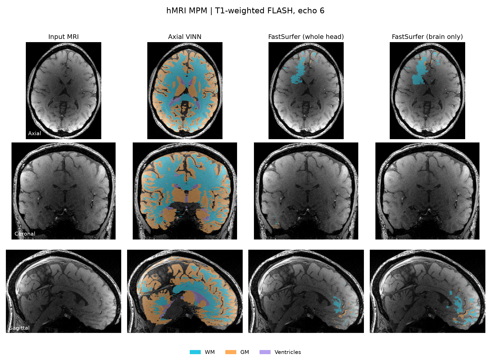

# hMRI MPM echo 6 comparison

The public hMRI toolbox example contains a 3 T T1-weighted Siemens 3D multi-echo FLASH scan at 0.8 mm isotropic resolution. Echo 6 (TE 13.8 ms, TR 25 ms, flip angle 21°) offers a public late-echo GRE comparison for the MULTIPLEX use case. [hMRI example dataset](https://doi.org/10.1016/j.dib.2019.104132) · [T1-weighted echo 6 source](https://github.com/hMRI-group/hMRI-toolbox-demodata/blob/2d772dade3a5c2433f11ab324cf4f91f82e123b2/raw-data/t1w_mfc_3dflash_v1i_R4_0015/anon_s2018-02-28_18-26-190921-00001-01344-6.nii) · [MULTIPLEX acquisition paper](https://doi.org/10.1002/mrm.28999)

## Processing

- **Axial VINN.** SynthStrip v1 produced the mask. The masked source intensities were passed to the VINN CLI with `--clip` for 0.5th–99.5th percentile clipping and nonzero-voxel z-score normalization. The model used `best.pth`, 0.8 mm in-plane spacing from the header, and CUDA with batches of 16 slices.
- **FastSurfer.** The official three-view aseg+DKT stage was run on the original scan and repeated on the same SynthStrip-masked image used by VINN. Both used FastSurfer's default conformation and intensity mapping, CUDA with batches of eight slices, and CPU view aggregation. Reduced aseg labels were mapped onto the original MRI grid with nearest-neighbor interpolation. [FastSurfer v2.6.1](https://github.com/Deep-MI/FastSurfer/releases/tag/v2.6.1) · [Official three-view weights](https://zenodo.org/records/10390573)

## Results



*Views use the closest-canonical source grid and retain the acquisition tilt. Source image from Callaghan et al., hMRI toolbox example, CC BY 4.0. The overlays were generated for this comparison.* [Dataset and attribution](https://github.com/hMRI-group/hMRI-toolbox-demodata/tree/2d772dade3a5c2433f11ab324cf4f91f82e123b2)

| Method and input | Labeled foreground (mL) | SynthStrip mask coverage | WM (mL) | GM (mL) |
| --- | ---: | ---: | ---: | ---: |
| Axial VINN, brain only | 1576.5 | 99.2% | 531.4 | 701.0 |
| FastSurfer, whole head | 69.4 | 4.4% | 50.1 | 18.7 |
| FastSurfer, same brain-only input | 89.3 | 5.6% | 70.0 | 18.2 |

Mask coverage is the fraction of the 1588.2 mL SynthStrip mask assigned a nonzero label. For FastSurfer whole-head and brain-only runs, the WM Dice agreement with VINN was 0.131 and 0.165, and the GM agreement was 0.038 and 0.035. The tissue groups follow the [BrainWeb benchmark mapping](brainweb20.md#evaluation-protocol).

FastSurfer triggered its low-volume warning on both inputs. The VINN overlay covers most of the brain mask and shows slice-to-slice discontinuities in the coronal and sagittal views. The case measures foreground coverage and prediction agreement. Anatomical accuracy requires independent reference labels.

The same FastSurfer command reported 1.28 L of segmented foreground on the standard MPRAGE scan of MR-ART subject `sub-000103` and passed the built-in volume check. [MR-ART dataset](https://doi.org/10.18112/openneuro.ds004173.v1.0.2)

## Reproduce the comparison

Download echo 6 from the source above and save it as `echo6.nii`. Run SynthStrip v1 to obtain `brain-mask.nii.gz` and `echo6-brain.nii.gz`. Keep the masked image and the mask on the source grid. The example used axis reordering to LIA for SynthStrip and applied its binary mask back to the original source data.

```bash
python -m fastsurfer_vinn.inference --input echo6-brain.nii.gz --output vinn.nii.gz \
  --clip --device cuda --batch-size 16
```

Run the following from a FastSurfer v2.6.1 checkout with its segmentation dependencies installed. Use absolute paths for the two inputs and the output directory.

```bash
python -m FastSurferCNN.run_prediction --t1 /path/echo6.nii --sid whole \
  --sd /path/results --device cuda --viewagg_device cpu --batch_size 8 \
  --aseg_name mri/aseg.auto_noCCseg.mgz
python -m FastSurferCNN.run_prediction --t1 /path/echo6-brain.nii.gz --sid brain \
  --sd /path/results --device cuda --viewagg_device cpu --batch_size 8 \
  --aseg_name mri/aseg.auto_noCCseg.mgz
```

Back in this repository, generate the figure and JSON report.

```bash
python -m benchmarks.compare_aseg --image echo6.nii --brain-mask brain-mask.nii.gz \
  --vinn vinn.nii.gz --fastsurfer /path/results/whole/mri/aseg.auto_noCCseg.mgz \
  --fastsurfer-brain /path/results/brain/mri/aseg.auto_noCCseg.mgz \
  --output-dir outputs/hmri-mpm-echo6 --title "hMRI MPM | T1-weighted FLASH, echo 6"
```
